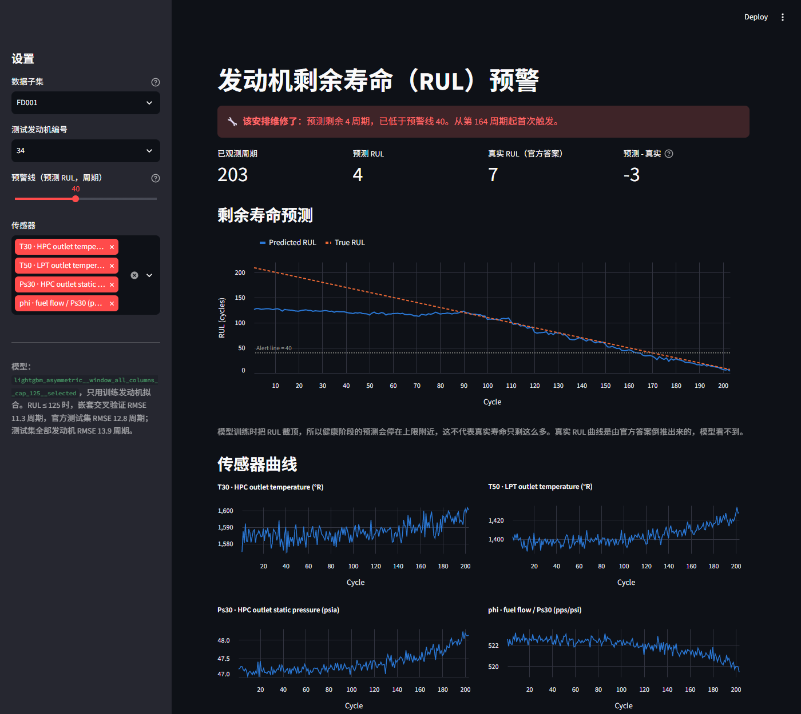

# 发动机剩余寿命（RUL）预测

用 NASA C-MAPSS 涡扇发动机退化仿真数据（FD001–FD004），预测设备还能运行多少个周期，并在快要故障时提示安排维修。项目的类比场景是矿用卡车和设备的预测性维护。

**结果**：FD001 的 100 台官方测试发动机上，RMSE 从线性回归基线的 21.90 降到 **13.92 个周期**，官方评分从 1314 降到 274（越小越好）。流程扩展到了多工况、多故障模式的另外三个子集，并用嵌套交叉验证评估了完整的选择流程。

重点不只是分数，而是**防止数据泄漏**和**讲清楚提升来自哪里、代价是什么**：按发动机切分数据，配对比较每一项改动，并把踩过的坑如实记录下来。



上图是 FD001 第 34 号测试发动机：预测 RUL 4，真实 RUL 7。这台的误差比平均小，只用来展示预警界面，整体水平见下面的结果表。健康状态的截图在 [docs/app_healthy.png](docs/app_healthy.png)。

## 结果

### 四个子集的最终模型

| 子集 | 工况 / 故障模式 | 默认配置 CV | **嵌套 CV** | 测试 RMSE（全部） | 测试 RMSE（RUL ≤ 125） | 官方分数 |
|---|---|---:|---:|---:|---:|---:|
| FD001 | 1 / 1 | 14.04 | **11.32 ± 0.83** | 13.92 | 12.83 | 274 |
| FD002 | 6 / 1 | 16.46 | **13.07 ± 0.67** | 25.82 | 12.02 | 6756 |
| FD003 | 1 / 2 | 14.16 | **12.15 ± 0.72** | 14.33 | 11.59 | 318 |
| FD004 | 6 / 2 | 16.55 | **13.76 ± 2.06** | 26.75 | 13.09 | 5091 |

- CV 的 RMSE 只统计真实 RUL ≤ 125 的周期。四个子集的嵌套 CV 都是 5/5 折好于默认配置。折数太少，这不是显著性检验。
- **嵌套 CV** 外层每一折都只用外层训练发动机，重新选特征集、超参数和损失权重，再预测留出的发动机。它估计的是这个选择流程，不是最终那个固定的模型。
- **官方测试集不参与训练和选择，但不是完全独立的证明**：开发时看过它的结果，并因此改过验证指标、固定过截顶（见“踩过的坑”）。
- CV 和测试的 RUL 分布、观测长度都不同，RUL ≤ 125 的两列只能作参考对照，不是同分布估计。
- FD002、FD004 的全部发动机 RMSE 高很多，主要因为 22–27% 的测试发动机 RUL 大于 125，而截顶 125 的模型会低估它们 40 多个周期。

详见 [notebooks/03_extensions.ipynb](notebooks/03_extensions.ipynb)。

### FD001 上的模型对比（默认参数）

选模型只看交叉验证（按发动机分 5 折）。完整的 14 组实验见 [results/FD001/summary.csv](results/FD001/summary.csv)，详见 [notebooks/02_modeling.ipynb](notebooks/02_modeling.ipynb)。

| 模型 | 特征 | RUL 标签 | CV RMSE（RUL ≤ 125） | 测试 RMSE | 测试官方分数 |
|---|---|---|---:|---:|---:|
| **LightGBM** | **窗口** | **截顶 125** | **14.04 ± 0.82** | **14.57** | **309** |
| 随机森林 | 窗口 | 截顶 125 | 14.44 ± 0.98 | 14.44 | 311 |
| 线性回归 | 窗口 | 截顶 125 | 19.39 ± 1.48 | 18.58 | 625 |
| LightGBM | 单点读数 | 截顶 125 | 20.76 ± 1.91 | 18.08 | 957 |
| 线性回归（基线） | 单点读数 | 截顶 125 | 21.18 ± 1.73 | 21.90 | 1314 |
| LightGBM | 窗口 | 不截顶 | 24.98 ± 3.00 | 27.02 | 6625 |
| 线性回归 | 单点读数 | 不截顶 | 33.98 ± 4.76 | 31.90 | 13221 |

LightGBM 和随机森林基本打平：CV 上 LightGBM 好 0.40，测试集上随机森林好 0.13。这个差距没有实际意义。

### 提升来自哪里

这些是相同 5 折上的配对比较（CV RMSE 的变化）。只换模型种子时，CV RMSE 的标准差约 0.03。

| 改动 | CV RMSE 变化 | 5 折中更好的折数 |
|---|---:|---:|
| 不截顶 → 截顶 125（LightGBM，窗口） | -10.94 | 5/5 |
| 单点读数 → 窗口特征（LightGBM，截顶） | -6.72 | 5/5 |
| 线性回归 → LightGBM（窗口，截顶） | -5.35 | 5/5 |
| 线性回归 → LightGBM（单点读数，截顶） | -0.42 | 2/5 |
| 去掉 Nc、NRc → 保留（LightGBM，窗口，截顶） | -1.16 | 5/5 |
| 全部列 → 人工筛选后的列（LightGBM，窗口，截顶） | -0.07 | 3/5 |
| 默认配置 → 完整选择流程，FD001（嵌套 CV） | -2.72 | 5/5 |

**解读**

- **RUL 高时信号比噪声弱，所以截顶收益最大**：RUL 从约 233 降到约 125，退化指标的均值只变化 0.44，而单个样本的标准差就有 0.68。不截顶就等于让模型去拟合噪声。
- **单点噪声是所有模型的共同瓶颈**：只用单点读数时，换成 LightGBM 几乎没有提升；加上窗口特征后，树模型才明显胜出，因为退化是加速的，这种弯曲关系线性模型拟合不了。
- **窗口特征贡献了约 89% 的分裂增益**，其中均值 64%、斜率 21%、标准差 3%。增益最高的是 HPC 出口温度（T30）的窗口均值，这和 FD001 的 HPC 退化故障模式相符，但特征重要性不能证明因果。这是默认模型的数字。

### 不对称损失的取舍

官方评分对报晚（高估寿命）罚得更重，所以试了加权平方损失：报晚的误差乘以权重。规则事先定好：CV 分数至少降 10%，RUL ≤ 125 的 RMSE 最多升 5%，满足时选分数最低的。四个子集的最终选择都是权重 5。

| 子集 | 测试 RMSE（RUL ≤ 125）对称 → 权重 5 | 测试 RMSE（全部）对称 → 权重 5 | 官方分数 对称 → 权重 5 |
|---|---:|---:|---:|
| FD001 | 13.07 → 12.83 | 13.58 → 13.92 | 291 → 274 |
| FD002 | 12.71 → 12.02 | 24.42 → 25.82 | 4845 → **6756** |
| FD003 | 13.10 → 11.59 | 14.23 → 14.33 | 394 → 318 |
| FD004 | 13.98 → 13.09 | 25.43 → 26.75 | 4015 → **5091** |

**这不是免费的提升。** FD002、FD004 的分数变差，几乎全部来自 RUL > 125 的发动机：FD002 这一段从 4238 升到 6333，其余发动机合计从 607 降到 423。权重让预测整体下移，RUL ≤ 125 的报晚减少，但本来就被截顶低估的发动机被低估得更多。

选择规则只看 RUL ≤ 125，所以这个代价进不了决策。规则是看结果前定的，我没有因为测试结果推翻它，只如实记录。如果业务关心健康阶段的绝对寿命，就不该用这个模型。

## 数据探索的发现

详见 [notebooks/01_eda.ipynb](notebooks/01_eda.ipynb)，这部分只看 FD001。

- **7 列完全恒定**（`setting_3` 和 sensor 1、5、10、16、18、19），FD001 只有一种工况，这些量没有理由变化。
- **12 个传感器变化方向一致**，在单台发动机内部和 RUL 的相关绝对值为 0.63–0.81。
- **Nc、NRc 的方向因发动机而异**：sensor_9 有 71 台净上升、29 台净下降。虽然全局相关弱，但去掉它们反而变差，说明它们有信息。
- **没有明显的退化拐点**：退化是连续加速的，所以 125 是合理的工程取值，不是物理常数。

## 预警线

界面默认的预警线是预测 RUL ≤ 40。下表来自嵌套 CV 的外层预测，每台发动机的预测都来自没见过它的整个选择流程，不是测试集。

| 子集 | 阈值 | 未预警的发动机 | 首次预警时真实 RUL 中位数 | 首次预警时最低 RUL | 首次预警时 RUL > 100 的台数 | 健康周期误报率 |
|---|---:|---:|---:|---:|---:|---:|
| FD001 | 40 | 0 | 40 | 27 | 0 | 0% |
| FD002 | 40 | 0 | 40 | 23 | 0 | 0% |
| FD003 | 40 | 0 | 39 | 28 | 0 | 0% |
| FD004 | 40 | 0 | 39 | 22 | 3 | 0.22% |

其他阈值见 `results/<子集>/final.json` 的 `alerts_nested`。

矿卡提前检修只是多花一点计划内成本，半路趴窝的代价通常大得多，所以方向上偏向提前。但这里没有维修成本模型，上表不能证明 40 是最优阈值。实际阈值应由维修周期和停机成本决定。

## 技术栈

Python 3.12 · pandas · scikit-learn · LightGBM · Jupyter · Streamlit · Altair · pytest

## 运行方法

下面是 Windows 的命令。macOS 或 Linux 把 `.venv/Scripts/python` 换成 `.venv/bin/python`。

```bash
python -m venv .venv
.venv/Scripts/python -m pip install -e ".[dev]"
.venv/Scripts/python scripts/download_data.py
```

启动界面（第一次打开每个子集时要训练模型，通常不到一分钟）：

```bash
.venv/Scripts/python -m streamlit run app/streamlit_app.py
```

可以用 `http://localhost:8501/?subset=FD004&engine=5` 直接打开某个子集的某台发动机。

运行测试：

```bash
.venv/Scripts/python -X utf8 -m pytest -q
```

重跑全部实验要按顺序跑两步，结果写入 `results/<子集>/`。第一步是默认参数的模型对比。第二步要读第一步的结果，耗时 2 个多小时（开发用的笔记本上两次分别约 2 小时 14 分和 2 小时 22 分）：

```bash
.venv/Scripts/python -X utf8 scripts/train_models.py
```

```bash
.venv/Scripts/python -X utf8 scripts/tune_models.py
```

如果想精确复现依赖版本，可以改用 `requirements-lock.txt`。

## 目录结构

```
├─ app/streamlit_app.py     界面
├─ notebooks/
│  ├─ 01_eda.ipynb          数据探索（FD001）
│  ├─ 02_modeling.ipynb     模型对比和解释（FD001，默认参数）
│  └─ 03_extensions.ipynb   四个子集、搜索、不对称损失、预警
├─ scripts/
│  ├─ download_data.py      下载数据
│  ├─ train_models.py       默认参数的实验
│  └─ tune_models.py        嵌套 CV 和最终选择
├─ src/rul/
│  ├─ data.py               读取、RUL 标签、按发动机切分
│  ├─ features.py           滑动窗口特征、工况归一化
│  ├─ models.py             模型 Pipeline
│  ├─ asymmetric.py         报晚加权的 LightGBM、权重规则
│  ├─ experiments.py        实验配置、最终模型
│  ├─ tuning.py             随机搜索、选择流程、嵌套 CV
│  ├─ evaluate.py           交叉验证、测试集评估
│  ├─ alerts.py             预警指标
│  ├─ metrics.py            RMSE、官方评分
│  ├─ results.py            写结果文件
│  └─ inference.py          界面用的预测逻辑
├─ results/                 各子集的指标（JSON、CSV）
├─ docs/review/             Codex 三轮评审的原文和处理结论
└─ tests/
```

## 设计取舍

**按发动机切分，而不是按行切分。** 同一台发动机相邻周期的读数几乎一样。按行随机切分等于让模型提前见过验证发动机，分数会虚高。这里用 `GroupKFold`，并有测试检查训练和验证的发动机没有交集，还用“间谍模型”确认训练时确实看不到验证发动机。

**特征处理在每一折内部拟合。** 工况聚类、归一化、方差筛选和标准化都只看训练折。恒定列由方差筛选自动去掉，不写死在代码里，因为不同子集恒定的列不同。

**多工况子集先按工况归一化。** FD002、FD004 有 6 种工况，原始读数被工况切换主导。这里用 KMeans 按操作设置聚类，再在每种工况内做 z 分数。

**窗口特征只看过去。** 部署时无法知道未来的读数，有测试确认改动未来的周期不会影响当前特征。默认窗口是 30，搜索范围是 10–50；轨迹比窗口短时，用已有的周期计算。

**验证指标只统计 RUL ≤ 125 的周期。** 这是有信号、也影响维修决策的区间。所有指标都和未截顶的真实 RUL 比较，截顶只影响训练标签。这个指标对截顶模型有利，所以我同时报告了全周期 RMSE，这上面不截顶反而更好（37.32 对 47.25），因为截顶模型不会预测超过 125 的值。

**截顶固定 125，不参与搜索。** 主要指标看不到 RUL > 125 的误差，让它选截顶一定会偏向低值。截顶的取舍单独报告在 `tuning.json` 的 `cap_sensitivity_cv`。

**嵌套 CV 包住整个选择流程。** 特征集、超参数和权重都在外层训练发动机内部选择。如果只嵌套超参数搜索，其他选择仍然看过验证发动机，成绩会偏乐观。

**用随机搜索，不用网格。** 20 组随机配置加默认配置。多数参数影响不大，随机搜索更省。

**用加权平方损失，不直接优化官方分数。** 官方分数是指数函数，大误差处梯度爆炸，训练不稳定。加权平方损失只有一个参数，也容易解释。

**不用 LSTM。** 项目时间更适合把树模型和防泄漏讲透。LSTM 可以作为后续工作。

## 过程中踩过的坑

- **第一版验证方式不合理。** 我按测试集的轨迹长度随机截断验证发动机，得到 CV RMSE 39，而测试集只有 21.9。排查后发现模拟的 RUL 最高到 313，单个样本就能罚几十万分，分数被极端点主导，于是改成现在的指标。**这次改动是在看到测试结果后做的**，后续模型都按这个指标选，所以测试集不算完全独立。
- **把截顶放进搜索，所有子集都选了 100。** CV 大幅变好（FD001 11.69），官方测试却变差（FD001 16.98、FD002 31.55）。原因是指标看不到 RUL > 125 的误差。这也是看到测试结果后才发现的，修正后截顶固定为方案已确认的 125。
- **嵌套 CV 一开始没有包住完整流程。** 特征集和权重是在外面选的，看过全部训练发动机。Codex 评审发现后，我把三步合成一个 `select_pipeline`，在外层每一折重跑。
- **超参数先取整再读回训练。** 结果文件把所有浮点数保留 4 位，最终模型用的其实不是搜索出来的那组参数。现在模型配置不取整，并有测试。
- **权重 1 不等于普通 LightGBM。** 开启列抽样时，自定义目标的随机流不同，预测逐点不相等，只是误差水平相同。所以比较权重时要用同一个包装器的权重 1 做基线。
- **恒定传感器产生了噪声特征。** 恒定信号的滚动斜率因浮点误差变成 1e-14 量级的数值，骗过了方差筛选。特征重要性表里斜率列比其他列多 4 个，才暴露这个问题。修复后 CV 从 13.83 变成 14.04，也就是说修复并没有提高分数，但这些列确实是噪声，所以保留修复。
- **结果文件不能逐字节复现。** 随机森林多线程汇总预测时有 1e-13 量级的抖动，指标保留 4 位小数后解决。第一次修改其实没有生效，是用 `diff` 比较两次运行的结果才发现的。

本地 Codex 评审了三轮，原文和每条意见的处理结论在 [docs/review/](docs/review/)。

## 已知局限

- **仿真数据不等于真实矿卡。** C-MAPSS 是发动机仿真数据，传感器噪声和退化模式都是模型生成的。真实设备还有维修记录缺失、工况多变、传感器损坏等问题。这里的数字不能外推到矿卡，能迁移的是方法。
- **官方测试集看过**：它是基准，不是独立证明。要得到干净的估计，需要冻结整个方案后用新的发动机检验。
- **搜索范围有边界**：窗口 50 和权重 5 都是候选的上限，更大的值可能更好，没有测试。
- **选择规则看不到健康阶段**：权重的代价不进入决策。
- **截顶造成低估**：真实 RUL 大于 125 的发动机，FD001 平均低估约 20 个周期，FD002、FD004 约 45 个周期。
- **中段误差仍然较大**：FD001 真实 RUL 在 61–125 时 RMSE 为 16.05，而 ≤ 30 时为 4.48。
- **短历史的发动机容易报晚**：观测周期少时平均误差偏正，比如 FD004 观测 51–100 周期时平均 +12.93。
- **预警可能反复**：预测有波动，触发后可能短暂回到预警线之上。这里没有做平滑，界面会用“需要留意”提示。
- **没有维修成本模型和显著性检验**：“5/5 折更好”只描述这组划分，预警表也不能证明总成本更低。
- **测试样本少**：FD001、FD003 只有 100 台发动机，官方分数又容易被少数大误差主导，所以小差异不应过度解读。

## 数据出处和许可证

- **数据集**：Turbofan Engine Degradation Simulation Data Set（C-MAPSS），NASA Ames Prognostics Data Repository。
- **论文**：A. Saxena, K. Goebel, D. Simon, N. Eklund, “Damage Propagation Modeling for Aircraft Engine Run-to-Failure Simulation”, PHM 2008（压缩包内的 readme 也引用这篇论文）。
- **下载**：`scripts/download_data.py` 从 `phm-datasets.s3.amazonaws.com` 下载约 12.4 MB 的压缩包，解压到 `data/raw/`。原始数据不进 git。
- **许可证**：data.gov 上 NASA C-MAPSS 相关条目的记录没有给出明确的许可证条款，我也没能打开 NASA 数据仓库的原始页面核对。因此本仓库不分发数据，只提供下载脚本并注明出处。如果要把数据用于研究以外的用途，请先自行向 NASA 确认。
- **数据说明**：压缩包 readme 写 FD004 训练 248 台、测试 249 台，实际文件是训练 249 台、测试 248 台（RUL 也是 248 行）。这里以实际文件为准。

**未核对原文的部分**：传感器名称表来自转引 Saxena 2008 的论文（arXiv 2605.02507、2503.07854），评分函数来自 C-MAPSS 文献的通行定义，这两处都没有直接对照论文原文。
